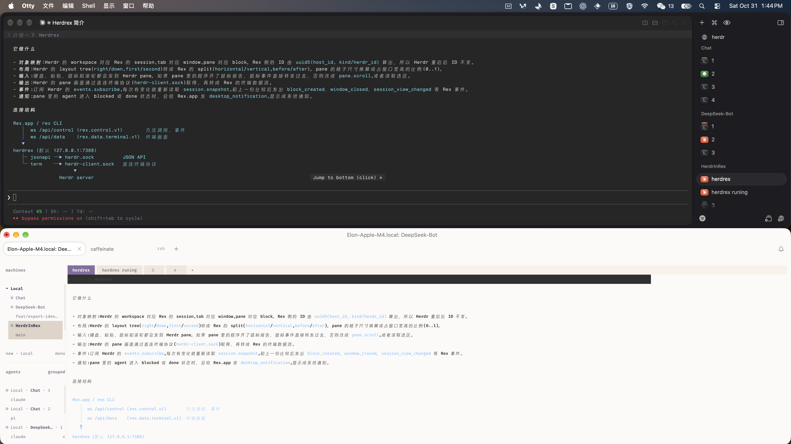

# Herdrex

Bridge of Herdr and Rex. [中文](README.zh-CN.md)

Herdrex serves a Herdr server as a Rex host. Rex.app and the `rex` CLI connect to it like any other host and see Herdr's workspaces as sessions, its tabs as windows and its panes as blocks. Typing, pasting, mouse and wheel input go to the Herdr pane, and the pane's screen streams back through Herdr's direct terminal protocol.



## Requirements

- [Rex](https://www.superlogical.com/rex/docs): download [Rex.app for macOS](https://blob.superlogical.com/download/rex-app/preview/latest.dmg). Linux has only the server: see [Linux installation](https://www.superlogical.com/rex/docs/linux/installation).
- [Herdr](https://herdr.dev/)
- For `herdrex ssh`: `ssh` on this machine, and Herdr running on the other one.

## Install

```sh
# add the tap (github.com/elonnzhang/homebrew-tap), then install
brew tap elonnzhang/tap
brew install elonnzhang/tap/herdrex
# upgrade to the latest release
brew update && brew upgrade elonnzhang/tap/herdrex
# or
go install github.com/elonnzhang/herdrex/cmd/herdrex@latest
# or download the release binary (macOS and Linux, amd64 and arm64)
curl -fsSL https://raw.githubusercontent.com/elonnzhang/Herdrex/main/install.sh | sh
```

`install.sh` downloads the archive for your system from the latest [GitHub Release](https://github.com/elonnzhang/Herdrex/releases), checks it against `checksums.txt`, and installs `herdrex` beside the one already on your PATH, else in `/usr/local/bin` or `~/.local/bin`. Run it again to update. `HERDREX_VERSION=v0.1.0` picks a release, `HERDREX_INSTALL_DIR` the directory. Pushing a `v*` tag builds the archives for all four platforms in GitHub Actions (`.github/workflows/release.yml`).

`herdrex update` (or `herdrex upgrade`) does the upgrade for you through the way you installed it: `brew update` and `brew upgrade` for a Homebrew install, `go install ...@latest` when the binary is in `$GOBIN` or `$GOPATH/bin`, and `install.sh` again for a binary it installed. For a binary anywhere else, such as one built from source, pick with `--channel brew|go|script`; `--dry-run` prints the commands without running them. A herdrex that is already running keeps the old version until you restart it.

## Usage

There are two ways to run it: serve the Herdr on this machine, or serve one on another machine over SSH.

| Command | What it does |
|---|---|
| `herdrex` | serves a Herdr running on this machine |
| `herdrex ssh HOST` | reaches a Herdr on another machine, then serves it here |
| `herdrex test` | starts a throwaway Herdr and serves it, to try Rex without touching yours |

`herdrex test` starts a Herdr at `/tmp/herdr/herdr-for-rex.sock`, serves it on 127.0.0.1:7388 as Rex host `herdr-in-Rex`, and on Ctrl+C removes that host, stops the server and deletes its socket, config and state.

### Serve the Herdr on this machine

```sh
herdrex --add-host        # serve the default Herdr on 127.0.0.1:7388, and add it to your Rex hosts
rex -S herdr ls           # the rex CLI now lists Herdr's workspaces as sessions
```

`--add-host` runs `rex hosts add`, which writes to your Rex home and syncs to all your devices; `--add-host=NAME` picks another name, and an existing host of that name has its endpoint replaced. Rex.app does not read those hosts: add the host in Rex.app under Settings > Remote Host, with the name and address herdrex prints when it starts, or scan the QR code it prints for each address.

Without `--herdr-socket`, the bridge finds Herdr's socket as `herdr` does: `HERDR_SOCKET_PATH`, then `HERDR_SESSION`, then the default session (`~/.config/herdr/herdr.sock` when `XDG_CONFIG_HOME` is unset).

```sh
herdrex                                    # Herdr at the default socket, on 127.0.0.1:7388
herdrex --herdr-socket /tmp/x.sock --port 7392
herdrex --start --herdr-socket /tmp/x.sock # start a new Herdr server there, stop it on Ctrl+C
herdrex --new                              # start a new one under /tmp, stop and remove it on Ctrl+C
herdrex --daemon                           # in the background, until kill PID
```

Without `--start` the bridge serves the Herdr already running at the socket. With `--start` it starts a new Herdr server there, with its config and state beside the socket (`x.sock`: `x.d`), and stops it on exit; it refuses a socket where a server is running, or one that would share your own Herdr's config. `--new` does the same at a socket of its own, `/tmp/herdrex-XXXX/herdr.sock`, and removes the server's files on exit too.

herdrex runs in the foreground until Ctrl+C. `--daemon` runs it in the background instead, in a session of its own so that it outlives the terminal: it returns once the bridge serves, or prints why it failed, and logs to `<user cache dir>/herdrex/herdrex-PORT.log` (`--log FILE` picks another). `kill PID`, with the pid it prints, stops it as Ctrl+C would.

### Serve a Herdr on another machine

```sh
herdrex ssh HOST                 # HOST is an SSH config alias
herdrex ssh -p 2222 user@host    # or any destination, with SSH's own options
herdrex ssh HOST --lan           # also serve it on this machine's LAN address
herdrex ssh HOST --herdr-socket /tmp/x.sock          # the Herdr at an existing remote socket
herdrex ssh HOST --start --herdr-socket /tmp/x.sock  # start a new one there; Ctrl+C stops it
herdrex ssh HOST --new                               # start a new one under /tmp; Ctrl+C stops it
```

`herdrex ssh` reads the socket of the Herdr running on the remote host, carries both of Herdr's sockets to this machine, and serves them as a Rex host here, so the panes on that machine appear in Rex.app as if they were local. Unless you start one with `--start` or `--new`, the remote Herdr must already be running; a server started that way runs on the remote host with its config and state beside its socket (`x.sock`: `x.d`), refuses to touch your own Herdr, and is stopped, with its files removed, when you press Ctrl+C. Ctrl+C closes the bridge and the SSH connection.

It picks the best transport the SSH server allows:

1. Unix socket forwarding through the SSH control master (`ssh -L`).
2. One SSH session carrying every connection, with a small Perl relay on the remote host.
3. Herdr's own `remote-api-bridge` and `remote-client-bridge`, one SSH session per connection, as `herdr --remote` does.

The local bridge starts at 7388 and moves to the next free port when `--port` is omitted; an explicit `--port` is used as given. `herdrex ssh` takes the same bridge flags as `herdrex` (`--port`, `--ts`, `--lan`, `--allow`, `--allow-for`, `--notify`, `--add-host`); `--ip` and `--listen` are not supported. SSH connection options go to `ssh`, before the destination; `herdrex ssh` refuses remote commands, `-N`, and `-f`, since the connection is the tunnel.

`--lan`, `--ts`, `--allow` and `--allow-for` work as they do for `herdrex`, before or after the destination. Files pasted into a pane (Rex's file upload) are written to the remote host's temporary directory over the same SSH connection, so the path typed into the pane exists where that pane's programs run.

## Who may connect

The bridge has no authentication, so by default it listens on loopback only, where only this machine can reach it.

- `--ts` also serves this machine's Tailscale address (100.64.0.0/10, fd7a:115c:a1e0::/48). Every tailnet device that Tailscale lets reach this machine may use it, since Tailscale has already authenticated that device.
- `--lan` also serves LAN addresses: bare `--lan` takes the LAN address on `en0`, and `192`, `172`, `10`, `ipv6`, an IP or a CIDR select others. Repeat `--lan` for several. If `en0` has no LAN address, name one explicitly, as `--lan 192` or `--lan 192.168.1.5`.
- A LAN address is served, but no LAN device may connect until `--allow` names the networks or addresses that may, as CIDR or bare addresses, comma-separated or repeated. Every other LAN caller gets 403. `--allow all` admits every address. `--allow-for 2h` limits `--allow` to that long after start (`30m`, `2h`); after that LAN callers get 403, while loopback and Tailscale callers are not affected. It needs `--allow`. So `--lan` alone opens nothing.

In a foreground terminal, herdrex prints each address it serves with its QR code, loopback included.

```sh
# this machine only
herdrex --add-host

# tailnet devices, no --allow needed
herdrex --ts --add-host=studio

# tailnet devices and one LAN subnet, on port 1234
herdrex --ts --lan --port 1234 --allow 192.168.1.0/24 --add-host

# this machine's addresses in the 192.* and 10.* ranges, for this machine only
herdrex --lan 192 --lan 10 --port 1234
```

## Notifications

When an agent in a pane is blocked or done, the bridge sends Rex.app a `desktop_notification`, which Rex.app shows as a system notification. `--notify=false` turns this off.

## Limits

Herdr has no floating layers, detached blocks, Lua scripts or client actions, so the Rex methods for them fail. `docs/PROTOCOL.md` lists every method and event with its mapping, and section 6 lists the known gaps.

## Packages

One Go module, `github.com/elonnzhang/herdrex`. The packages under `pkg/` can be used on their own.

| Package | Contents |
|---|---|
| `pkg/rex` | Rex protocol types: hello, welcome, requests, responses, events, error and close codes, the session view |
| `pkg/rex/client` | Rex client: dial `unix://`, `http://` or `https://`, make calls, read events in order, open a block's terminal stream |
| `pkg/rex/server` | Rex server framework: the handshake, event seq, request order, attachments and the events they select, clients, data tickets |
| `pkg/rex/termstream` | Encoding and decoding of the terminal data stream |
| `pkg/herdr` | Herdr's socket path rules |
| `pkg/herdr/jsonapi` | Client for Herdr's JSON API (`herdr.sock`) |
| `pkg/herdr/term` | Client for Herdr's direct terminal protocol (`herdr-client.sock`) |
| `pkg/herdr/endpoint` | Client for Herdr's endpoint protocol (`herdr-client.sock`) |
| `pkg/herdr/cli` | Wrapper for the `herdr` command: version, status, sessions, schema, and an isolated `herdr server` |
| `internal/bridge` | The mapping from Rex methods to Herdr calls and from Herdr events to Rex events |

## Development

```sh
go test ./...
REX_TEST_SERVER=http://127.0.0.1:7388 go test ./pkg/rex/client/   # also runs against a live Rex server or bridge
HERDREX_TRACE=1 ./bin/herdrex ...                                  # logs every request, event and frame
HERDR_TEST_SOCKET=/tmp/hx-live/herdr.sock HERDR_TEST_BIN=$(command -v herdr) go test -p 1 -run Live ./pkg/herdr/...   # live tests, isolated Herdr only
HERDR_SOCKET_PATH=path/to/herdr-socket herdr                         # enter herdr
```

The test with `REX_TEST_SERVER` creates a session on that server and destroys it at the end. The `pkg/herdr` live tests create and close workspaces and tabs, so point `HERDR_TEST_SOCKET` at a Herdr server started only for them (`docs/TESTING.md`); the `cli` test starts its own. `docs/TESTING.md` sets up an isolated Herdr, Rex server and Rex client under `/tmp/rexbridge`, so tests don't touch the ones you use every day.

## Docs

The docs are in Chinese.

- `BRIDGE.md`: one diagram of how herdrex sits between Rex and Herdr, and how their objects, input, output and events map
- `docs/PROTOCOL.md`: how the two sides map, the mapping and status of every method and event, the test checklist
- `docs/herdr-api.md`: the Herdr socket API (basis of `pkg/herdr/jsonapi`)
- `docs/herdr-client-protocols.md`: the direct terminal protocol and the endpoint protocol on Herdr's client socket, and how they differ
- `docs/rex-api.md`: the Rex control and data protocols (basis of `pkg/rex`)
- `docs/ref/`: per-method field tables, generated by `tools/apidoc/gen.py`
- `docs/TESTING.md`: the isolated test environment
- `docs/remote-herdr.md`: how `herdrex ssh` reaches a remote Herdr
