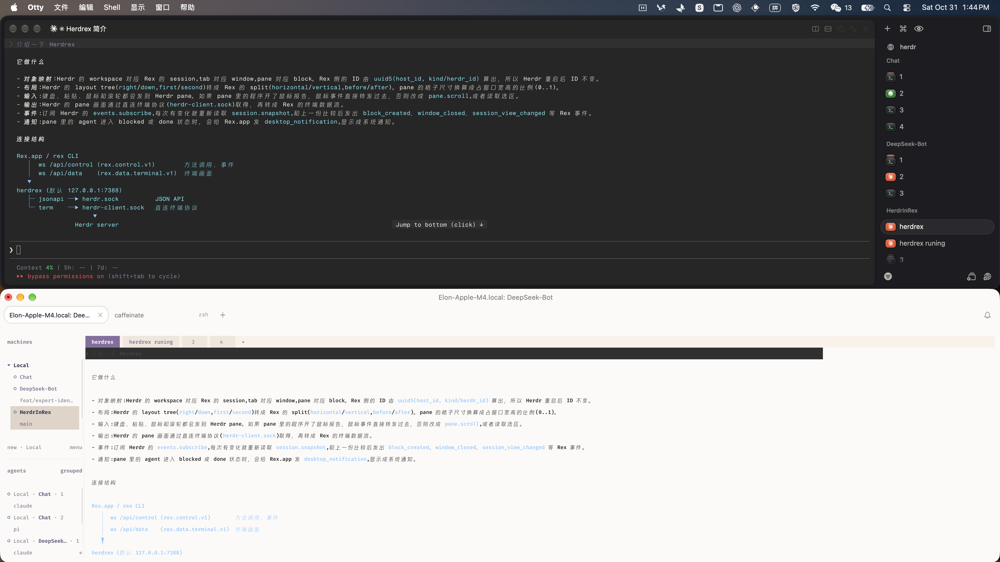

# Herdrex

Bridge of Herdr and Rex. [English](README.md)

Herdrex 把一个 Herdr server 当作 Rex host 提供出去。Rex.app 和 `rex` 命令行像连普通 host 一样连它:Herdr 的 workspace 显示为 session, tab 显示为 window, pane 显示为 block。打字、粘贴、鼠标和滚轮都送到 Herdr 的 pane, pane 的画面经 Herdr 的直连终端协议传回来。



## 依赖

- [Rex](https://www.superlogical.com/rex/docs):下载 [macOS 版 Rex.app](https://blob.superlogical.com/download/rex-app/preview/latest.dmg);Linux 只有 server,见 [Linux 安装](https://www.superlogical.com/rex/docs/linux/installation)。
- [Herdr](https://herdr.dev/)
- 用 `herdrex ssh` 时,本机要有 `ssh`,另一台机器上要有正在运行的 Herdr。

## 安装

```sh
# 先添加 tap(github.com/elonnzhang/homebrew-tap),再安装
brew tap elonnzhang/tap
brew install elonnzhang/tap/herdrex
# 升级到最新版本
brew update && brew upgrade elonnzhang/tap/herdrex
# 或
go install github.com/elonnzhang/herdrex/cmd/herdrex@latest
```

## 用法

有两种用法:把本机的 Herdr 提供出去,或经 SSH 把另一台机器上的 Herdr 拿到本机来提供。

| 命令 | 作用 |
|---|---|
| `herdrex` | 提供本机正在运行的 Herdr |
| `herdrex ssh HOST` | 连到另一台机器上的 Herdr,在本机提供 |
| `herdrex test` | 新起一个临时的 Herdr 提供出去,用来试 Rex,不动你自己的 Herdr |

`herdrex test` 在 `/tmp/herdr/herdr-for-rex.sock` 新起一个 Herdr,在 127.0.0.1:7388 以 Rex host `herdr-in-Rex` 提供;Ctrl+C 后删除它加的 host,停掉这个 server,删掉它的 socket、config 和 state。

### 提供本机的 Herdr

```sh
herdrex --add-host        # 在 127.0.0.1:7388 提供默认的 Herdr,并以 "herdr" 加入 Rex hosts
rex -S herdr ls           # rex 命令行现在把 Herdr 的 workspace 列成 session
```

`--add-host` 调用 `rex hosts add`,会写入你的 Rex home 并同步到你的所有设备;`--add-host=NAME` 换一个名字,已有同名 host 时替换它的 endpoint。Rex.app 不读这些 host:要在 Rex.app 的 设置 > Remote Host 里按 herdrex 启动时打印的名字和地址添加,或者直接扫它为每个地址打印的二维码。

不给 `--herdr-socket` 时,桥接按 `herdr` 的顺序找 socket:`HERDR_SOCKET_PATH`,然后 `HERDR_SESSION`,最后是默认 session(没设 `XDG_CONFIG_HOME` 时在 `~/.config/herdr/herdr.sock`)。

```sh
herdrex                                    # 默认 socket 上的 Herdr,在 127.0.0.1:7388
herdrex --herdr-socket /tmp/x.sock --port 7392
herdrex --start --herdr-socket /tmp/x.sock # 在那里新起一个 Herdr server,Ctrl+C 时停掉
herdrex --daemon                           # 在后台运行,直到 kill PID
```

不加 `--start` 时,桥接使用 socket 上已经在运行的 Herdr。加 `--start` 时,在这个 socket 新起一个 Herdr server,config 和 state 放在 socket 旁边(`x.sock` 对应 `x.d`),退出时停掉;socket 上已有 server 在运行,或会和你自己的 Herdr 共用 config 时拒绝。

herdrex 在前台运行,直到 Ctrl+C。加 `--daemon` 改在后台运行,在自己的会话里,关掉终端也不退出:桥接开始服务后才返回,失败时打印原因;日志写到 `<用户缓存目录>/herdrex/herdrex-PORT.log`(`--log FILE` 指定别的文件)。用它打印的 pid `kill PID` 停止,效果与 Ctrl+C 相同。

### 提供另一台机器上的 Herdr

```sh
herdrex ssh HOST                 # HOST 是 SSH config 里的别名
herdrex ssh -p 2222 user@host    # 或者任意目标,ssh 自己的选项原样传过去
herdrex ssh HOST --lan           # 同时在本机局域网地址上提供
```

`herdrex ssh` 读出远端正在运行的 Herdr 的 socket,把 Herdr 的两个 socket 拿到本机,再在这里提供为 Rex host:那台机器上的 pane 在 Rex.app 里和本地的一样。远端 Herdr 必须已在运行。Ctrl+C 关掉桥接和 SSH 连接。

它按 SSH 服务端允许的方式,依次尝试:

1. 经 SSH control master 做 Unix socket 转发(`ssh -L`)。
2. 用一个 SSH 会话承载所有连接,远端跑一小段 Perl 脚本做转发。
3. Herdr 自带的 `remote-api-bridge` 和 `remote-client-bridge`,每个连接一个 SSH 会话,与 `herdr --remote` 相同。

本地桥接从 7388 开始,没指定 `--port` 时端口被占用就逐个加 1;显式指定时按指定的来。SSH 连接选项原样传给 `ssh`,写在目标前面;连接本身就是要维持的隧道,所以 `herdrex ssh` 不接受远端命令、`-N` 和 `-f`。

`--lan`、`--ts`、`--allow` 和 `herdrex` 一样,写在目标前后都可以。粘贴进 pane 的文件(Rex 的文件上传)经同一条 SSH 连接写到远端的临时目录,所以输入 pane 的路径在 pane 里程序所在的机器上存在。

## 谁能连进来

桥接没有鉴权,所以默认只监听回环地址,只有本机能连。

- `--ts` 另外监听本机的 Tailscale 地址(100.64.0.0/10、fd7a:115c:a1e0::/48)。Tailscale 允许连到本机的 tailnet 设备都能用:这些设备已经过 Tailscale 认证。
- `--lan` 另外监听本机的局域网地址:不带值时用 `en0` 的局域网 IP,`192`、`172`、`10`、`ipv6`、具体 IP 或 CIDR 选择别的;要多个就重复写 `--lan`。`en0` 没有局域网 IP 时显式指定,例如 `--lan 192` 或 `--lan 192.168.1.5`。
- 局域网地址会被监听,但没给 `--allow` 时局域网设备都连不上;`--allow` 给出允许连入的局域网网段或地址(CIDR 或单个地址,逗号分隔或重复),名单外的局域网连接一律回 403。所以只写 `--lan` 不会放开任何外部访问。

在前台终端运行时,herdrex 为它提供的每个地址打印地址和二维码,包括回环地址。

```sh
# 只有本机
herdrex --add-host

# tailnet 设备,不需要 --allow
herdrex --ts --add-host=studio

# tailnet 设备和一个局域网网段,监听 1234 端口
herdrex --ts --lan --port 1234 --allow 192.168.1.0/24 --add-host

# 本机 192.* 和 10.* 的地址,只有本机能用
herdrex --lan 192 --lan 10 --port 1234
```

## 通知

pane 里的 agent 需要处理(blocked)或完成(done)时,桥接给 Rex.app 发 `desktop_notification`,由 Rex.app 弹系统通知。`--notify=false` 关闭。

## 限制

Herdr 没有浮动层、detached block、Lua 脚本和客户端动作,对应的 Rex 方法会失败。每个方法和事件的映射见 `docs/PROTOCOL.md`,已知差异在第 6 节。

## 包

一个 Go module `github.com/elonnzhang/herdrex`。`pkg/` 下的包可以单独用。

| 包 | 内容 |
|---|---|
| `pkg/rex` | Rex 协议类型:hello、welcome、请求、响应、事件、错误码和关闭码、session view |
| `pkg/rex/client` | Rex 客户端:dial `unix://`、`http://` 或 `https://`,发起调用,按顺序读事件,打开 block 的终端流 |
| `pkg/rex/server` | Rex server 框架:握手、事件序号、请求顺序、attachment 及其选择的事件、客户端、data ticket |
| `pkg/rex/termstream` | 终端数据流的编解码 |
| `pkg/herdr` | Herdr 的 socket 路径规则 |
| `pkg/herdr/jsonapi` | Herdr JSON API(`herdr.sock`)的客户端 |
| `pkg/herdr/term` | Herdr 直连终端协议(`herdr-client.sock`)的客户端 |
| `pkg/herdr/endpoint` | Herdr endpoint 协议(`herdr-client.sock`)的客户端 |
| `pkg/herdr/cli` | `herdr` 命令的封装:version、status、sessions、schema,以及隔离的 `herdr server` |
| `internal/bridge` | Rex 方法与 Herdr 调用的映射,以及 Herdr 事件到 Rex 事件的映射 |

## 开发

```sh
go test ./...
REX_TEST_SERVER=http://127.0.0.1:7388 go test ./pkg/rex/client/   # 另外对一个运行中的 Rex server 或桥接跑一遍
HERDREX_TRACE=1 ./bin/herdrex ...                                  # 记录每个请求、事件和帧
HERDR_TEST_SOCKET=/tmp/hx-live/herdr.sock HERDR_TEST_BIN=$(command -v herdr) go test -p 1 -run Live ./pkg/herdr/...   # 实测,只对隔离的 Herdr
HERDR_SOCKET_PATH=path/to/herdr-socket herdr                         # 进入 herdr
```

带 `REX_TEST_SERVER` 的测试会在那个 server 上建一个 session,结束时销毁。`pkg/herdr` 的实测会创建、关闭 workspace 和 tab,所以 `HERDR_TEST_SOCKET` 要指向专门为它起的 Herdr server(`docs/TESTING.md`);`cli` 的实测自己起 server。`docs/TESTING.md` 在 `/tmp/rexbridge` 下搭一套隔离的 Herdr、Rex server 和 Rex 客户端,测试不会碰你日常用的那一套。

## 文档

- `BRIDGE.md`:一张图说明 herdrex 怎样连接 Rex 和 Herdr,以及对象、输入、输出和事件怎样对应
- `docs/PROTOCOL.md`:两侧的对应关系、每个方法和事件的映射与状态、验证清单
- `docs/herdr-api.md`:Herdr socket API 规格(`pkg/herdr/jsonapi` 的依据)
- `docs/herdr-client-protocols.md`:Herdr client socket 上的直连终端协议与 endpoint 协议,能力差异和优劣
- `docs/rex-api.md`:Rex 控制与数据协议规格(`pkg/rex` 的依据)
- `docs/ref/`:逐方法字段表,由 `tools/apidoc/gen.py` 生成
- `docs/TESTING.md`:隔离测试环境
- `docs/remote-herdr.md`:`herdrex ssh` 怎样连到远端的 Herdr
